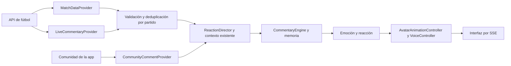

# LIVE Providers v6

SIMULATION conserva el estudio y el partido completo de 24 pasos. LIVE usa otra instancia del mismo `ReactionDirector`, sin fabricar goles, estadísticas ni minutos. El selector **Modo de datos** cambia la fuente; marcador, contexto, CommentaryEngine, personalidad, memoria, predicciones, voz, avatar y escenarios utilizan los mismos motores.

## Configuración

1. Copia `.env.example` como `.env` en la raíz del repositorio.
2. Elige `FOOTBALL_PROVIDER=http-json` o `api-football` y configura sus variables.
3. Arranca con `pnpm dev`, o `pnpm build` y `pnpm start`. Node 22+ carga `.env` solo en el proceso del servidor.
4. Abre el estudio servido por ese proceso y selecciona **LIVE**. La aplicación empieza en SIMULATION y no llama a la API antes de seleccionar LIVE.

No escribas claves en React, en el HTML, en una URL del navegador ni en Git. `.env` está ignorado. El estado HTTP/SSE y los logs públicos no contienen claves, cabeceras, URLs privadas ni mensajes de error recibidos del proveedor. Los endpoints y secretos solo se configuran al arrancar el servidor; cambiar proveedor requiere reiniciarlo.

`FOOTBALL_PROVIDER=none`, valor predeterminado, deja LIVE **Sin configurar** y SIMULATION operativo. Una configuración inválida tampoco impide arrancar SIMULATION. El HTML portátil permite alternar para ver este diagnóstico, pero necesita el servidor para recibir datos reales de forma segura; conserva la simulación completa sin conexión.

### API-Football v3

`FOOTBALL_PROVIDER=api-football`, `FOOTBALL_API_KEY` y, opcionalmente, `FOOTBALL_MATCH_IDS` con hasta 20 IDs de fixture separados por comas. Sin IDs descubre hasta 20 partidos en directo y sigue consultando los que desaparecen de la lista para obtener su final. Usa el endpoint oficial `https://v3.football.api-sports.io`; no supone que otro producto o proxy tenga el mismo contrato.

El adaptador normaliza fixtures, goles, tarjetas, cambios, VAR, estadísticas y alineaciones. Las capacidades dependen de competición, plan y cobertura de la API. Las estadísticas se cachean 30 s y las alineaciones 120 s. Si faltan o fallan, aparecen como no disponibles; no se sustituyen por estadísticas simuladas. Este proveedor no presupone un endpoint de narración minuto a minuto: de forma predeterminada usa eventos estructurados. Ajusta `LIVE_POLL_MS` y el número de partidos a las cuotas de tu contrato; cada fixture requiere solicitudes de eventos y, cuando caduca su caché, estadísticas y alineaciones.

Los eventos de API-Football no traen timestamp individual absoluto. El adaptador conserva una estimación y la marca `timestampQuality: estimated`; el motor usa la recepción para ordenar temporalmente la memoria y la cola, sin afirmar precisión que la fuente no ofrece. El minuto original se conserva.

### HTTP JSON normalizado

`FOOTBALL_PROVIDER=http-json`, `FOOTBALL_MATCHES_URL=https://tu-servidor/matches` y, si hace falta autenticación Bearer, `FOOTBALL_API_KEY`. El endpoint devuelve un array del formato común siguiente. Este adaptador permite conectar un backend de otro proveedor sin modificar el motor.

Para narración, configura por separado `FOOTBALL_COMMENTARY_URL` y, si corresponde, `FOOTBALL_COMMENTARY_API_KEY`. Devuelve un array de incidentes del mismo contrato. Su clave es independiente: nunca se reenvía automáticamente la de datos deportivos a otro endpoint. La ausencia de narración o su fallo activa el fallback con eventos.

## Contratos comunes

`packages/live-data/src/contracts.ts` define:

- `MatchDataProvider.getMatches(signal)`: snapshots autoritativos de varios partidos y sus eventos.
- `LiveCommentaryProvider.getCommentary(matches, signal)`: narración normalizada opcional, con IDs estables y partido explícito.
- `CommunityCommentProvider.process(input, now)`: comentarios de nuestra app con ID, partido, usuario, texto y timestamp. `AppCommunityCommentProvider` valida, recorta y deduplica antes de usar la cola y memoria existentes. No se conecta a redes sociales ni envía mensajes fuera de la aplicación.

Se reexportan también en `integrations/contracts.ts`; el contrato mock `SportsDataProvider` anterior sigue disponible. Los tipos internos están en `packages/shared/src/live.ts`. Las respuestas JSON se validan antes de modificar el contexto: IDs, tipos, estados, rangos, números finitos, equipos y tamaño de arrays/cuerpo.

El endpoint de partidos devuelve un array como este:

```json
[
  {
    "id": "fixture-123",
    "league": { "id": "liga", "name": "Liga" },
    "home": { "id": "celta", "name": "Celta" },
    "away": { "id": "rival", "name": "Rival" },
    "minute": 67,
    "status": "live",
    "score": { "home": 0, "away": 0 },
    "statistics": {
      "home": { "possession": 61, "shots": 10, "shotsOnTarget": 4, "fouls": 7 },
      "away": { "possession": 39, "shots": 5 }
    },
    "updatedAt": 1792433220000,
    "incidents": []
  }
]
```

`status`: `upcoming`, `live`, `halftime`, `finished`. `updatedAt`, `timestamp` y `receivedAt` usan epoch en milisegundos UTC, nunca segundos. Posesión va de 0 a 100. Se aceptan `xG`, `yellow`, `red`, `corners` y `fouls` además de tiros. Un campo estadístico omitido o `null` significa desconocido; cero significa cero observado. La UI muestra «—» para desconocidos y el comentario no atribuye xG a equipos sin esos datos. Las probabilidades del radar siguen siendo estimaciones locales, no probabilidades oficiales de la API.

`lineups`, opcional, tiene arrays `home` y `away`, con `{name, number?, position?}`. Se muestra en los detalles del partido. Los campos `home.shortName` y `away.shortName` son opcionales.

Un incidente, en `incidents` o en el endpoint independiente de narración:

```json
{
  "id": "comment-987",
  "matchId": "fixture-123",
  "kind": "narration",
  "channel": "commentary",
  "side": "home",
  "minute": 67,
  "timestamp": 1792433220000,
  "player": "Borja Iglesias",
  "text": "67' Borja Iglesias remata de cabeza, parada del portero",
  "correlationId": "play-456"
}
```

El adaptador añade `provider`, `receivedAt` y `sourceIds`; ningún texto recibido se ejecuta como instrucción. Tipos admitidos: `kickoff`, `second_half`, `goal`, `chance`, `missed_chance`, `yellow`, `red`, `penalty`, `var`, `substitution`, `halftime`, `fulltime`, `shot`, `save`, `corner`, `foul`, `dangerous_attack`, `narration`.

Para más precisión, el proveedor puede enviar hechos interpretados: `player`, `playerOut`, `action` (`header`, `shot`, `cross`) y `outcome` (`saved`, `missed`, `blocked`, `goal`, `post`). `side` identifica al equipo que produce la acción; para una parada identifica al atacante que remató. Es opcional cuando no se conoce o la acción no tiene equipo, como VAR. `timestampQuality` puede ser `exact` o `estimated`; la omisión equivale a exacto.

El normalizador reconoce patrones de remate, cabeza, parada, fuera, córner, falta, ataque peligroso y VAR en español/inglés. El motor genera una reacción propia con esos hechos y las estadísticas disponibles, sin usar el texto fuente como locución. Por ejemplo: «¡Ufff! Borja Iglesias la ha buscado de cabeza. El portero sostiene el marcador». La interpretación local tiene un vocabulario limitado; para narraciones libres complejas, el adaptador debe suministrar los hechos normalizados o podrá conectarse otro intérprete en esa frontera.

## Flujo y contexto



`LiveDataSession` coordina la ingestión; no contiene otro motor de comentarios ni otra memoria. Actualiza snapshots sin llamar al simulador de eventos, evitando sumar goles, tiros, posesión o xG artificiales. Los eventos observados resuelven las predicciones por el flujo existente. Las transiciones de estado generan inicio, descanso, segunda parte y final si el proveedor no aporta esos eventos. Los eventos se procesan antes del final del partido para resolver las predicciones con el desenlace observado.

Cada partido conserva su propio contexto, eventos, fuentes y memoria. Los mensajes usan `ChatQueue → SamuIABrain → CommentaryEngine`; se responde a los pendientes cuando el director está libre y la interacción comunitaria está habilitada. El análisis puede incorporar la última acción y las respuestas reales a una encuesta. La personalidad modula el comentario como antes.

Al cambiar de modo se detiene la reproducción actual y se conservan por separado los partidos, memoria y chat de ambas sesiones. Perfil y ajustes visuales se comparten al alternar. Los controles deportivos manuales solo operan en SIMULATION; el servidor los rechaza en LIVE. La identidad y los PNG oficiales permanecen sin cambios, y se mantienen los contratos de avatar y voz. LIVE no convierte automáticamente la voz simulada del servidor en audio personalizado.

## Duplicados y orden

- Se recuerdan IDs por proveedor, canal y partido durante reconexiones. Un mismo hecho no vuelve a observarse ni publicarse.
- Evento y narración se fusionan por `correlationId` compatible; si falta, se busca coincidencia única de minuto, equipo, familia de acción, jugador y proximidad temporal. Los tiros/paradas sin jugador o sin correlación se tratan de forma conservadora. Dos IDs distintos del mismo canal no se fusionan solo por compartir minuto.
- Los hechos se observan inmediatamente para actualizar el contexto y resolver predicciones antes de su vencimiento. Solo la publicación espera una ventana de 1,5 s para incorporar detalles de otro canal. Una narración tardía puede enriquecer el hecho observado sin volver a comentarlo.
- Si dos acciones del mismo minuto son ambiguas, el adaptador debe aportar la correlación; no se elimina una ocasión distinta por adivinación.
- El primer snapshot de cada encuentro establece la línea base y carga su historia sin narrar de nuevo todos sus goles. Solo los hechos nuevos disparan reacciones. Hechos exactos de más de 3 minutos se archivan sin locución; los timestamps estimados usan la recepción para arbitrar la cola.
- Snapshots con `updatedAt` anterior al ya aplicado se descartan. El marcador autoritativo puede bajar por una corrección; no se incrementa artificialmente por recibir de nuevo un gol. El contrato actual no implementa un libro completo de rectificaciones arbitrales de recuerdos ya publicados: una anulación retrospectiva puede requerir reconciliar predicciones y comentarios previos, además de corregir el marcador.

## Errores, reconexión y caché

Polling configurable (15 s por defecto), una solicitud en curso por sesión, cancelación al salir de LIVE, timeout real incluso si un adaptador ignora AbortSignal y protección frente a respuestas tardías. Los reintentos usan backoff exponencial de 1 a 60 s y respetan `Retry-After` hasta 5 minutos. El proveedor de narración reintenta por separado y no impide aplicar primero el marcador estructurado.

Se conservan los últimos snapshots durante un error. El minuto no avanza por el reloj de simulación. Tras 45 s sin recepción se marcan como pendientes/desactualizados; el comentario editorial automático queda bloqueado cuando la conexión no está fresca. La pantalla muestra proveedor, estado, última recepción, próximo intento, fallback, duplicados y un registro limitado a 100 códigos sin secretos.

La caché de deduplicación dura 4 horas y tiene un máximo de 30.000 claves; los cuerpos HTTP se limitan a 4 MiB. Los historiales, eventos y recuerdos conservan los límites existentes. Todo es memoria temporal de proceso: reiniciar el servidor comienza otra sesión; no se ha añadido almacenamiento persistente.

## Verificación y alcance

Se prueban contratos, parseo de texto, adaptación API-Football con respuestas de fixture, caché, marcador autoritativo, estadísticas ausentes, deduplicación, contextos múltiples, fallback, reconexión, Retry-After, timeout y cancelación. Se comprueba por HTTP la protección de LIVE y la vuelta a SIMULATION. El navegador recorre un feed HTTP de prueba hasta comentario, emoción, reacción, voz y pantalla; el HTML offline prueba la alternancia sin solicitudes externas. También se mantienen las pruebas del partido completo, memoria, voz y assets.

No se incluyen credenciales reales ni se presupone una suscripción. La conexión con API-Football contra partidos reales requiere la clave y cobertura contratadas; las pruebas automatizadas usan fixtures locales, no una API de pago.
