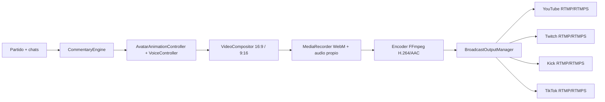

# Multiplataforma v7

La app separa la entrada de chats de la salida de vídeo. Activar un chat no inicia una emisión, y activar una salida no conecta su chat. SIMULATION y LIVE conservan sus motores, contexto por partido, memoria, personalidad, predicciones, voz y controlador del avatar.

## Probar sin emitir públicamente

1. Arranca el servidor y abre **Multiplataforma**.
2. Comprueba las dos previsualizaciones: 1280×720 (16:9) y 720×1280 (9:16).
3. Pulsa **Prueba local codificada**. Con FFmpeg instalado, el navegador genera WebM con audio y el servidor codifica H.264/AAC; los contadores muestran bytes reales para ambos formatos. Esta sesión no abre destinos públicos aunque alguno esté configurado y activado.
4. En SIMULATION, utiliza **Prueba de chats** para enviar mensajes de usuarios distintos y comprobar preguntas, tendencias y filtros. Se etiquetan como muestra simulada; no se atribuyen a una audiencia real.
5. Opcionalmente configura `BROADCAST_TTS=flite` para probar una voz local capturable y lanza un evento desde Dashboard. Hace falta un FFmpeg compilado con el filtro `flite`. La voz es una prueba inglesa, no una voz personalizada de SamuIA.
6. **Parar directo** detiene capturas, audio, encoders y conexiones.

El HTML portátil ofrece las dos previsualizaciones con los assets oficiales embebidos, pero la administración de proveedores y RTMP necesita el servidor. Nunca introduzcas claves en el HTML ni en React.

## Chats externos

`ExternalChatProvider` devuelve lotes normalizados y el siguiente intervalo de lectura. Cada mensaje conserva `platform`, `id`, `liveId`, `userId`, `username`, `message`, `timestamp`, `receivedAt` y, si existe, `replyTo`. Los IDs son propios del proveedor; no se confunden el ID del usuario, del canal y del directo. Las APIs no ofrecen todos los campos en todos los casos.

| Adaptador             | Entrada                                             | Configuración y límites                                                                                                                                                                                                                                                                                                |
| --------------------- | --------------------------------------------------- | ---------------------------------------------------------------------------------------------------------------------------------------------------------------------------------------------------------------------------------------------------------------------------------------------------------------------- |
| `YouTubeChatProvider` | API oficial `liveChatMessages.list`                 | OAuth y `YOUTUBE_LIVE_CHAT_ID`; conserva cursor y respeta `pollingIntervalMillis`. Si se facilita `YOUTUBE_VIDEO_ID`, se usa como ID de directo; si no, se usa el ID único de su hilo de chat. La API de mensajes utilizada no proporciona replies de forma general.                                                   |
| `TwitchChatProvider`  | IRC oficial sobre `wss://irc-ws.chat.twitch.tv:443` | Canal e ID del directo en `TWITCH_LIVE_ID`; lectura anónima o token/nick coincidentes. Solicita tags y commands, gestiona PING/PONG y RECONNECT, conserva ID, identidad, hora y reply tags. El ID de directo debe actualizarse para cada sesión: IRC solo expone el room ID.                                           |
| `KickChatProvider`    | Webhook oficial `chat.message.sent`                 | Public key de Kick y `KICK_LIVE_ID`. El servidor valida firma RSA-SHA256 sobre `messageId.timestamp.body`, fecha y tamaño antes de normalizar. La app/subscripción y los permisos deben configurarse en Kick para entregar a `/api/webhooks/kick`. No se registra una suscripción ni se abre un túnel automáticamente. |
| `TikTokChatProvider`  | Relay de una fuente oficialmente autorizada         | `TIKTOK_CHAT_RELAY_URL` y token. TikTok LIVE no se presupone como API pública disponible para cualquier cuenta. Sin acceso aprobado muestra **restricted**, sin recurrir a scraping ni endpoints privados.                                                                                                             |

Para TikTok, el relay autorizado devuelve `{ messages: ExternalChatMessage[], cursor?: string, pollAfterMs?: number }`; el adaptador fuerza `platform=tiktok` y valida el lote. Este contrato no concede permisos de TikTok: el operador debe disponer de acceso oficial a la fuente upstream. El mismo contrato puede sustituirse por un SDK oficial permitido sin tocar el cerebro.

Los conectores y salidas parten OFF, incluso si hay variables configuradas. Los lotes tienen timeout de 10 segundos y los reintentos usan backoff de 1 a 60 segundos, respetando Retry-After hasta cinco minutos. OFF cancela una lectura pendiente y rechaza callbacks tardíos. Un error de YouTube no desconecta Twitch, Kick ni TikTok. Los tokens OAuth deben ser válidos y tener los scopes correctos; la versión actual no incluye un flujo interactivo de login ni renovación de tokens.

## CommunityAnalyzer

`ExternalChatManager → ReactionDirector.receiveExternalChat → CommunityAnalyzer → ChatQueue / SamuIABrain / CommentaryEngine`

- Deduplica por plataforma, directo e ID, con memoria limitada y caducidad.
- Filtra bots declarados por la fuente, spam promocional, cadenas repetidas, repetición del mismo usuario, ráfagas y una lista básica de expresiones inapropiadas. Es una moderación inicial determinista, no un clasificador completo de bots o de todo lenguaje ofensivo.
- Separa usuarios por plataforma/directo/userId. Silenciar a Ana en Twitch no silencia a una Ana de YouTube. Las votaciones existentes conservan esa identidad para no mezclar participantes de igual nombre.
- Mantiene una muestra de dos minutos, cuenta usuarios distintos y detecta temas repetidos, preguntas y señales de sentimiento. No convierte mensajes repetidos de un único usuario en una mayoría.
- Solo atribuye tendencias de plataforma a muestras de al menos tres participantes. La división requiere como mínimo dos opiniones positivas y dos críticas. Presenta los recuentos de la muestra, sin afirmar que representan a todos los espectadores.
- Los resúmenes enlazan los IDs de mensajes realmente observados. Las preguntas relevantes pueden entrar en la respuesta automática al quedar libre el director, respetando su turno de voz. La interacción se desactiva con `communityInteractionLevel=0`.

Las opiniones y el sentimiento usan reglas sencillas de texto; no se presupone comprensión semántica completa. La personalidad sigue aplicándose al comentario y las encuestas publicadas no se sustituyen por votos inventados. Los comentarios permanecen en nuestra aplicación: no se envían respuestas textuales automáticamente a los chats de las plataformas.

## Señal de vídeo propia

`VideoCompositor` dibuja en canvas el escenario y personaje oficiales, marcador, minuto, competición, gráficos, comentario, estado de reacción y resumen de comunidad. Reorganiza el mismo contenido para ambas proporciones sin recortar el setup ni tapar el micrófono. No captura pantalla, pestañas, micrófono, cámara ni vídeo/audio del partido. Los únicos recursos visuales que carga son los assets de la app; el audio es el del proveedor TTS.

La identidad visual permanece intacta. El fallback actual sigue siendo una imagen estática. `CompositorAvatarAdapter` amplía el renderer existente con `renderToCanvas`; un renderer Live2D/VRM/WebGL puede usar los frames del mismo `AvatarAnimationController` para movimiento, expresión y lip-sync y entregar sus píxeles al canvas. La versión entregada no incluye un modelo con rig ni transforma toda la foto para fingir animación facial.

El navegador mezcla audio propio en un `MediaStreamAudioDestinationNode`; no usa loopback del sistema. La voz simulada y `SpeechSynthesis` no aportan por sí mismas una pista de audio capturable. El adaptador opcional `BroadcastVoiceProvider` genera WAV local con Flite, y espera las confirmaciones reales del reproductor antes de activar habla y finalizarla. El reloj y la duración del audio conducen al avatar; los visemas siguen siendo aproximaciones desde texto, no alineación fonética medida. Un futuro TTS puede sustituir este proveedor sin modificar las salidas.

La pestaña productora debe permanecer abierta y activa. El compositor se conserva al navegar por otras pantallas. El navegador puede reducir FPS en segundo plano; una producción autónoma 24/7 requeriría un renderer dedicado. Si el productor deja de enviar durante 15 segundos, el servidor detiene la sesión. Reiniciar el productor crea otra lease; fragmentos y callbacks de una sesión antigua se rechazan.

## Encoder y salidas

Hay un encoder por proporción. FFmpeg convierte WebM en H.264/AAC encapsulado en MPEG-TS y cada adaptador de destino lo remultiplexa por separado a FLV/RTMP. YouTube, Twitch y Kick comparten la codificación horizontal; TikTok usa la vertical. No se mezclan las claves de stream entre destinos.

Las cuatro clases separadas son `YouTubeBroadcastOutput`, `TwitchBroadcastOutput`, `KickBroadcastOutput` y `TikTokBroadcastOutput`. Cada una se puede activar/desactivar y reintentar por separado. El fallo de un destino no detiene los demás. El fallo de un encoder aísla su formato; recuperar ese encoder requiere reiniciar la captura para aportar otra cabecera WebM.

`live` se marca cuando FFmpeg informa de progreso de salida tras conectar, no al pulsar el botón. Significa que la señal está llegando al ingest; algunos paneles oficiales requieren publicar/iniciar el evento además de recibir señal (por ejemplo YouTube si auto-start no está activado). El panel de la plataforma sigue siendo la autoridad sobre publicación y audiencia.

Las escrituras están acotadas: un consumidor lento se desconecta y reconecta sin bloquear el fanout. Se limitan tamaños de fragmentos y colas. Los logs contienen códigos y plataforma, nunca URLs, claves o stderr crudo. Parar invalida callbacks antiguos y cierra procesos; el audio original del partido no entra en esta arquitectura.

## Administración y credenciales

Usa `.env.example` como plantilla. Todos los secretos se leen únicamente en el servidor:

- `YOUTUBE_RTMP_URL` + `YOUTUBE_STREAM_KEY`.
- `TWITCH_RTMP_URL` + `TWITCH_STREAM_KEY`.
- `KICK_RTMP_URL` + `KICK_STREAM_KEY`.
- `TIKTOK_RTMP_URL` + `TIKTOK_STREAM_KEY`.

Introduce la URL de servidor sin la clave; la app añade la clave por separado. Obtén ambos valores del panel oficial de cada cuenta. Se admiten `rtmp://` y `rtmps://`; no se aceptan archivos o URLs HTTP como destino de producción. TikTok puede no conceder stream keys a todas las cuentas: sin concesión oficial su salida permanece sin configurar, independientemente del resto.

Para título y categoría, YouTube admite la API oficial de vídeos con `YOUTUBE_ACCESS_TOKEN` y `YOUTUBE_VIDEO_ID`; Twitch utiliza `TWITCH_ACCESS_TOKEN`, `TWITCH_CLIENT_ID` y `TWITCH_CHANNEL_ID`. Deben tener permisos de escritura y categorías válidas. Kick y TikTok muestran la gestión de metadatos como no disponible en este adaptador y remiten al panel oficial. Una llamada rechazada no detiene la señal.

El panel deja activar/desactivar cada chat y destino, iniciar/parar, hacer una prueba codificada local, consultar estado/reintentos y actualizar metadatos cuando hay capacidad. **Iniciar directo** requiere una voz capturable configurada y al menos una salida habilitada con endpoint y clave. La prueba local puede funcionar con pista de silencio para verificar vídeo sin credenciales.

La aplicación conserva el servidor local en loopback por defecto. Para exponer su administración públicamente, utiliza autenticación y TLS en un proxy controlado; esta entrega no incorpora una gestión de cuentas de administrador. Los webhooks de Kick necesitan una URL pública HTTPS con su verificación de firma, sin publicar el resto del panel sin protección.

## Verificación

Se prueban normalizadores, replies, filtros, identidad, tendencias verificables, firmas Kick, cancelación y degradación independiente. Se verifica fanout por proporción, reconexión, callbacks obsoletos, límites y ausencia de secretos en snapshots. Se genera un WAV real con FFmpeg/Flite.

En navegador se captura el compositor en ambos formatos y se envía al encoder FFmpeg real, comprobando bytes H.264/AAC y reproducción TTS con reloj del avatar. El modo local impide abrir destinos públicos. Las pruebas de red social y RTMP usan fixtures o adaptadores controlados: no se ha publicado ningún directo real ni se han incluido credenciales de cuentas.
