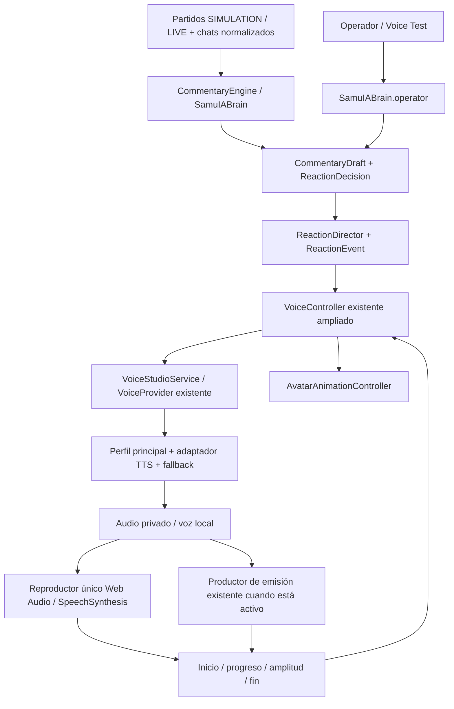

# Voice Studio v8

Esta fase evoluciona **SamuIA existente**. El texto de requisitos lo llamaba SembraIA; el usuario confirmó continuar en `melonweb3/SamuIA`. No se ha reconstruido la app, cambiado su identidad ni creado otro cerebro.

## Arquitectura encontrada

El texto ya lo generan `CommentaryEngine` y `SamuIABrain`, con personalidad, contexto, memoria y fuentes por partido. `ReactionDirector.perform` publica el borrador y lo entrega a `VoiceController` y `AvatarAnimationController`. Hay un director SIMULATION y otro LIVE; `MatchSimulationSession` mantiene el ensayo local aislado.

No había dos bots identificados con nombres propios. Los mecanismos reales eran:

| Mecanismo existente                                  | Audio y reproducción antes                                                               | Conservación en esta fase                                                                                                                 |
| ---------------------------------------------------- | ---------------------------------------------------------------------------------------- | ----------------------------------------------------------------------------------------------------------------------------------------- |
| `BrowserVoiceProvider`                               | Web Speech / `SpeechSynthesis`, voces locales del sistema; selector en Partido de prueba | Intacto, también disponible como preset **Voz local del navegador** en Voice Studio. Las voces disponibles dependen de cada navegador/SO. |
| `BroadcastVoiceProvider`                             | FFmpeg/Flite, WAV temporal, reproducción Web Audio dentro del productor de emisión       | Intacto como preset **Flite**, fallback capturable y proveedor anterior de Multiplataforma. Sigue siendo una voz inglesa de prueba.       |
| `SimulatedVoiceProvider` y alias `MockVoiceProvider` | Reloj sin sonido; `SimulationVoice` permite avanzar el ensayo                            | Intactos, preset **Simulación sin audio**. Nunca se presentan como audio clonado.                                                         |

No existe un SDK de OpenAI/ElevenLabs previo que pueda reutilizarse para clonación. El mock de integración OpenAI anterior se conserva. Los adaptadores nuevos utilizan HTTP oficial desde Node, sin exponer credenciales al frontend.

## Flujo único

`VoiceController` es el motor de voz reutilizado: no hay un segundo SembraVoiceEngine compitiendo con él. Conserva sus estados y añade `engineStatus`: `idle`, `generating`, `buffering`, `speaking`, `interrupted`, `error`. La pausa anterior sigue disponible. Expone reacción actual, texto, emoción, intensidad, prioridad, voz/proveedor efectivos, progreso, nivel y longitud de cola.

`ReactionEvent` amplía el borrador editorial con ID, origen, partido opcional, texto, emoción, intensidad, prioridad, interrumpibilidad, timestamp y perfil opcional. Un gol conserva el ID del hecho deportivo y `matchId`. Las APIs y chats nunca llaman directamente al TTS. El operador pasa por `SamuIABrain.operator`; su texto es una instrucción explícita del operador, no un comentario de chat leído automáticamente.

`SpeechSynthesisProvider` separa **generar audio remoto** de `VoiceProvider`, el contrato previo de reproducción. Declara disponibilidad, catálogo, capacidades, generación cancelable y creación/verificación cuando existen. La interfaz opcional `streamSpeech` prepara una futura reproducción incremental; esta entrega usa audio completo por frase. **Los adaptadores actuales no implementan reproducción progresiva**, aunque las APIs puedan ofrecerla. No se anuncian como streaming.

## Crear Samuel Voice

1. Instala dependencias con `pnpm install --frozen-lockfile`. Necesitas Node >=22, FFmpeg y ffprobe. Ejecuta `pnpm dev`, o `pnpm build` y `pnpm start`.
2. Configura únicamente en el servidor las variables de `.env.example` del proveedor elegido. Reinicia Node al cambiar `.env`. No pegues claves en React, grabaciones, nombres de perfil ni Git.
3. Abre **Voice Studio**, elige **VOICE PROVIDER**, escribe `Samuel Voice` y pulsa **Crear perfil**. Esto crea metadatos locales; todavía no una voz clonada.
4. Elige el perfil en **VOICE PROFILE**. En **Muestra de mi voz**, sube WAV, MP3 o M4A, o pulsa **RECORD VOICE SAMPLE** y después **Parar grabación**. La grabación requiere HTTPS o localhost y permiso de micrófono. Se muestra duración y un reproductor local para escuchar antes de enviar. Puedes borrar y repetir.
5. Pulsa **Enviar muestra al servidor privado**. Se valida tamaño, MIME, firma y contenido real de audio con ffprobe. WebM de MediaRecorder sin duración se normaliza temporalmente a WAV; no se inventa una duración.
6. Para OpenAI, selecciona **Consentimiento**, graba/sube **por separado** la frase oficial exacta en el idioma configurado y envíala. Configura `OPENAI_VOICE_CONSENT_TEXT` desde la guía oficial actual: la app no inventa ni sustituye esa frase. Para ElevenLabs, confirma propiedad y completa cualquier verificación adicional que el proveedor exija.
7. Marca la autorización de uso de **tu propia voz** y pulsa **CREATE CUSTOM VOICE**. Se envían las muestras al proveedor. La respuesta real aporta el ID; sin key no se llama al proveedor ni se inventa un ID. Si ElevenLabs responde `requires_verification`, queda **waiting-consent**, no Ready. Completa su proceso oficial y usa **Comprobar verificación del proveedor**.
8. Cuando esté **ready**, pulsa **Usar como DEFAULT VOICE**, configura un fallback (por ejemplo Flite), activa **Voice enabled** y **Activar audio en esta pestaña**.
9. **TEST MY VOICE** genera «Hola, soy SamuIA. La retransmisión está preparada.» con el perfil seleccionado. En **VOICE TEST / OPERATOR MESSAGE** escribe una frase nueva, elige emoción/intensidad/prioridad y pulsa **SPEAK / SAY NOW**. El perfil seleccionado listo tiene prioridad en esta prueba; si no, se usa DEFAULT VOICE.
10. En Dashboard lanza **Gol Celta**: el comentario editorial usa automáticamente la misma voz principal. Los comentarios de comunidad elegidos por el cerebro comparten el flujo. **STOP SPEECH / Callar** cancela audio, generación y mensajes manuales pendientes.

**Partido de prueba conserva su sesión aislada y su selector local anterior.** El perfil del servidor se usa en Dashboard/SIMULATION, LIVE, operador y emisión. Al entrar en el ensayo se cede la salida local para evitar solapar su reproductor con la voz del estudio; al salir vuelve a estar disponible. El HTML portátil conserva sus funciones anteriores y explica que clonación/Voice Studio requieren backend; nunca incluye claves ni grabaciones personales.

## Proveedores y variables

Todas las variables nuevas están vacías en `.env.example`:

| Proveedor              | Variables                                                                                                                                                         | Función y limitación                                                                                                                                                                   |
| ---------------------- | ----------------------------------------------------------------------------------------------------------------------------------------------------------------- | -------------------------------------------------------------------------------------------------------------------------------------------------------------------------------------- |
| OpenAI                 | `OPENAI_API_KEY`, opcional `OPENAI_TTS_MODEL` (por defecto `gpt-4o-mini-tts`), `OPENAI_VOICE_CONSENT_TEXT`, `OPENAI_VOICE_CONSENT_LANGUAGE` (por defecto `en-US`) | TTS genérico y custom voices desde audio. Creación/consentimiento sujetos a acceso de la cuenta. La frase debe corresponder al idioma; el proveedor valida identidad y consentimiento. |
| ElevenLabs             | `ELEVENLABS_API_KEY`, opcional `ELEVENLABS_TTS_MODEL` (por defecto `eleven_multilingual_v2`), `ELEVENLABS_VOICE_ID`                                               | Instant Voice Cloning y TTS. El preset por ID es una voz existente, no una clonación realizada por esta app. Verificación y plan pueden ser necesarios.                                |
| Flite                  | `FFMPEG_PATH`, `FFPROBE_PATH` cuando no están en PATH                                                                                                             | Preset local sin API key. `BROADCAST_TTS=flite` sigue habilitando el proveedor de emisión anterior; no es necesario para seleccionar Flite dentro de Voice Studio.                     |
| Navegador / simulación | Ninguna                                                                                                                                                           | La voz local no genera una pista capturable para emisión ni amplitud medida. La simulación no genera audio.                                                                            |
| Almacenamiento         | Opcional `VOICE_STORAGE_DIR`                                                                                                                                      | Por defecto `.local/voice-studio`, ignorado por Git; elige un directorio privado fuera de `public`/dist.                                                                               |

OpenAI traduce emoción/intensidad a `instructions` cuando el modelo lo admite; `tts-1`/`tts-1-hd` omiten instrucciones. ElevenLabs usa los ajustes compatibles del modelo, sin inventar un parámetro universal de emoción ni prometer que la entonación reproduzca exactamente la intensidad solicitada. Flite y Web Speech degradan a voz compatible. Velocidad común 0,7–1,2 y volumen 0–1.

Requisitos de muestras se entregan desde las capacidades del adaptador. El máximo de OpenAI verificado en el contrato es 10 MiB; ElevenLabs usa un límite operativo de esta app de 10 MiB. No se fija una duración mínima/recomendada universal ni se corta una grabación a un número arbitrario de segundos. El panel enlaza los requisitos oficiales y deja su validación final al proveedor. Las grabaciones se detienen al alcanzar el límite de transporte y se informa de ello.

## Interrupciones, errores y varias pestañas

- Un CRITICAL (gol o roja) interrumpe LOW/NORMAL/HIGH si la voz anterior permite interrupción y Voice Studio está habilitado con esa opción. Otro CRITICAL no se corta automáticamente. **INTERRUPT CURRENT SPEECH** del operador respeta también la protección de una reacción no interrumpible.
- Mensajes normales esperan; las colas tienen límites y orden por prioridad. Al cancelar se invalidan callbacks y resultados tardíos. Un chat cortado queda omitido, no se marca respondido por el final del gol.
- Se conserva el scheduler deportivo (suscripciones, filtros y máximos) y la deduplicación LIVE por hecho. El motor de voz deduplica IDs durante cinco minutos; operador y colas editoriales rechazan IDs ya publicados/pendientes. No se cachean comentarios dinámicos.
- Un fallo de generación reintentable puede repetirse una vez, después se intenta el fallback configurado. Si ambos fallan se publica error y el director queda libre para seguir. No se reintenta automáticamente crear clones para evitar duplicar recursos/cargos. Un fallo del dispositivo/autoplay se informa y requiere habilitar reproducción; no se solapan voces para ocultarlo.
- Una pestaña adquiere una lease privada y renueva su propiedad; otras pestañas no reproducen el mismo audio. Sin ack real de inicio el estado queda en preparación. Si se pierde un reproductor activo, se libera con error. Mientras emite, el productor existente toma el audio y el reproductor local se detiene.
- La salida capturable usa la voz configurada cuando hay principal/fallback compatible. Voz del navegador y simulación no pueden aportar audio al encoder; se usa un fallback capturable o el proveedor de emisión anterior. Se conserva la prueba local sin destinos públicos.
- Logs: selección, petición TTS, retry, fallback, audio preparado/iniciado/finalizado, interrupción y códigos de error. No registran texto de muestras, claves, tokens, cuerpos de error remotos ni audio.

## Persistencia y privacidad

La configuración y los perfiles se guardan con escritura atómica en `profiles.json`, directorio 0700 y archivo 0600. Incluye ID/nombre/proveedor/tipo/estado, ID de voz/consentimiento, default, fallback, volumen, velocidad y opción de interrupción. No contiene claves ni muestras. Un archivo ilegible/corrupto genera un aviso visible; no se presenta como configuración cargada correctamente.

Las muestras se mantienen en memoria acotada, caducan a los 30 minutos y se borran tras el intento de creación, al borrarlas o al cerrar el servidor. Los archivos temporales de validación/conversión se eliminan en `finally`. El frontend libera sus URLs blob y pistas del micrófono. El audio TTS actual solo se entrega al propietario de reproducción o a la lease privada del productor; no hay URLs permanentes públicas ni se incluye audio en SSE.

Eliminar un perfil borra los datos locales y muestras, **no elimina automáticamente la voz/consentimiento alojados en el proveedor**: se gestionan en su panel oficial. El servidor sigue destinado a uso local con loopback por defecto. Antes de compartirlo en Internet hace falta autenticación del panel y TLS; las leases de reproducción no sustituyen la autenticación de administrador.

## Preparación del avatar

`VoiceEvents` y snapshots conservan inicio, progreso, fin, cancelación/error, emoción/intensidad y amplitud 0–1. `AnalyserNode` mide el audio que se reproduce en Web Audio o en la emisión. `AvatarAnimationController.updateSpeechAmplitude` aplica apertura de boca con caducidad del nivel para no dejar una boca abierta tras perder datos. En pausa/preparación/fin la boca se cierra. SpeechSynthesis mantiene su simulación por texto porque no expone audio medible.

El contrato previo admite visemas/timestamps; `GeneratedSpeech.alignment` y el puerto incremental permiten incorporar futuros proveedores. Esta fase no incorpora alineación fonética ni rig facial. Las imágenes oficiales siguen siendo fallbacks estáticos, sin deformar ni mover el escenario.

## Archivos y validación

- Nuevos contratos: `packages/voice/src/contracts.ts`.
- Nuevos servidor: `voice-providers.ts`, `voice-studio.ts`, `voice-commands.ts`.
- Nuevos frontend: `VoiceStudio.tsx`, `VoiceStudioPlayer.ts`.
- Modificados: `VoiceController`, `ReactionDirector`, scheduler y `SamuIABrain`, tipos compartidos/puente de amplitud, servidor/SSE, productor de emisión, adaptadores locales, App/CSS, `.env.example`, documentación y HTML portátil.
- Pruebas añadidas: abstracción y HTTP de proveedores con fixtures, consentimiento/verificación, perfiles/almacenamiento privado, selección, errores, retry/fallback, cola, prioridades, cancelación, duplicados, callbacks tardíos, nivel de audio, operador y gol. Navegador: creación mediante **proveedor fixture explícito**, reproducción de WAV sintético medido, gol crítico, emisión propia y grabación MediaRecorder real con fuente sintética local. Se conservan los tests anteriores.

Ejecuta `pnpm lint`, `pnpm typecheck`, `pnpm test`, `pnpm build` y `CI=1 CHROMIUM_PATH=/usr/bin/chromium pnpm test:e2e`.

**No se ha creado ni escuchado una clonación real de Samuel en esta entrega.** Las integraciones se verifican con contratos y fixtures, no con una cuenta real ni una voz inventada presentada como clon. Para validar ese hito se necesitan tu muestra, consentimiento y una API key con acceso al proveedor. Tampoco se verifica salida física de altavoces en CI; sí decodificación, reproducción Web Audio, reloj y amplitud medidos en navegador.

Contratos consultados: [OpenAI OpenAPI](https://github.com/openai/openai-openapi/blob/master/openapi.yaml) (`audio/voice_consents`, `audio/voices`, `audio/speech`), [OpenAI Node voices](https://github.com/openai/openai-node/blob/master/src/resources/audio/voices.ts), [ElevenLabs IVC](https://github.com/elevenlabs/elevenlabs-js/blob/main/src/api/resources/voices/resources/ivc/client/Client.ts) y [TTS](https://github.com/elevenlabs/elevenlabs-js/blob/main/src/api/resources/textToSpeech/client/Client.ts). Comprueba elegibilidad y requisitos vigentes en las guías oficiales antes de grabar consentimiento o contratar un plan.
